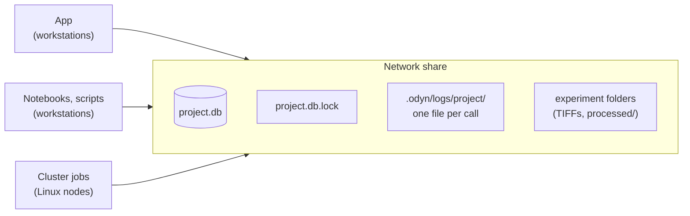
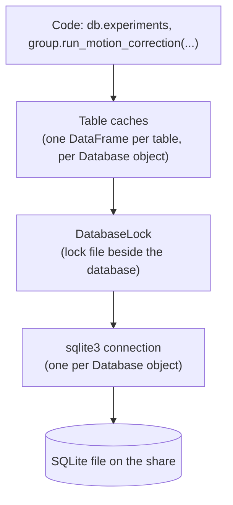
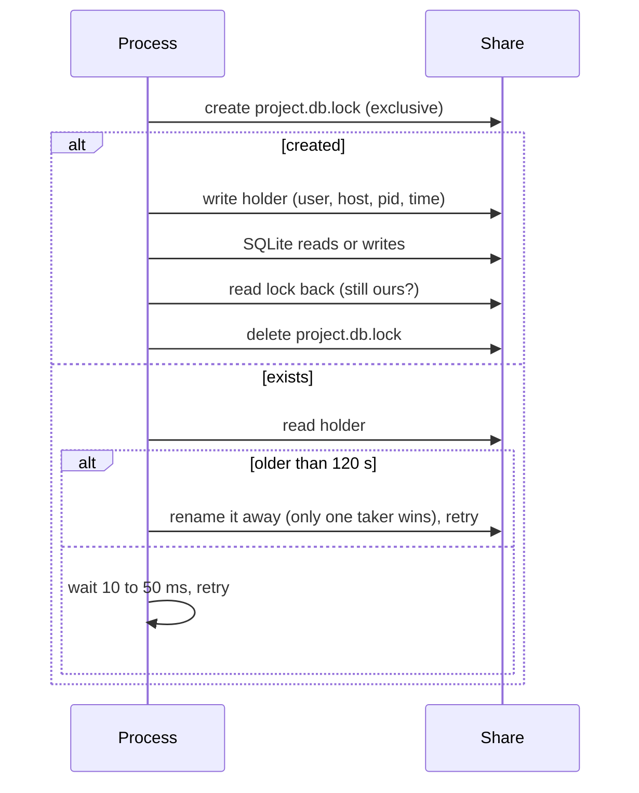
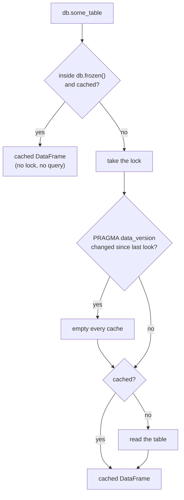
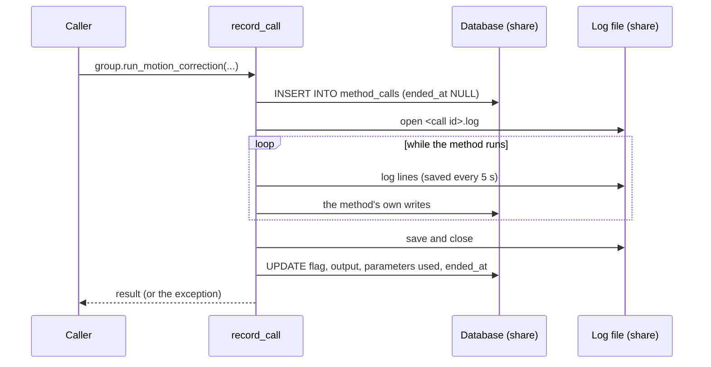

# How ODyn uses its database

This page explains how ODyn reads and writes its database: the lock, the
caches, the call logs and the migrations. It also lists what the design
assumes about the lab that uses it. If your lab works differently, the
section [When the assumptions change](#when-the-assumptions-change) says
what would have to change.

## The setting

ODyn keeps one SQLite file per project on the lab's network share, next to
the data. Three kinds of programs use it at the same time:

- **The app** on workstations (Windows, macOS): adding experiments, quality
  control, picking and approving motion corrections.
- **Notebooks and scripts** on workstations: analysis.
- **Cluster jobs** (Linux): motion corrections, reports, and a periodic
  "tick" that submits jobs and records how they ended.



Every file operation on the share is a network round trip: a few
milliseconds on the lab network, several times that over a VPN. Bandwidth
is rarely the limit. So the design counts round trips first and bytes
second.

## Layers



A `Database` object belongs to one thread: SQLite connections cannot be
shared between threads. The app runs all database work on one worker
thread, with a `Database` of its own. A `Group` reads through its
`Database`, with caches of its own for its rows.

## The lock

SQLite has its own locks, but they are not trusted here. A workstation and
a cluster node reach the share through different protocols and operating
systems, and do not see each other's SQLite locks. A reader that finds a
journal and no lock "recovers" the journal into the file, while the writer
is still writing. That corrupts the database.

So ODyn adds a lock of its own (`odyn/locking.py`): a file
`<database>.lock` beside the database. Creating a file that does not exist
yet (`O_CREAT | O_EXCL`) is a single step that every client sees the same
way. The lock is held for **every** use of the connection, reads included.



Details:

- **Re-entrant:** only the outermost `with` takes the file. Threads of one
  process wait on an in-process lock first.
- **Stale locks:** a lock older than `STALE_AFTER_S` (120 s) is taken over.
  Holds are meant to last well under that. A process that took longer and
  finds its lock taken over logs an error and asks for an integrity check.
- **Cost:** taking and releasing the lock is four or five round trips.
  On the lab network that was about 0.3 s per take, before any query.
- **Schema check:** each outermost take also checks `PRAGMA user_version`,
  so a process left open across a migration stops instead of writing
  through the old schema.
- `db.held()` holds the lock across several reads or writes, so the batch
  pays for it once. Everyone else waits meanwhile, so keep it short.
- Programs that do not know about the lock (DB Browser, R) must read a
  copy: `python -m odyn.admin <main_folder> [--project <name>] snapshot`
  writes one to a `snapshots` folder beside the database.

## Reading: the caches

Each table is read whole into a `DataFrame` and kept until something may
have changed it.



What empties the caches:

- **Another connection's commit.** `PRAGMA data_version` changes when any
  other connection has committed. Any commit, to any table, empties every
  cache.
- **This connection's own writes.** Each writer (`_writing`) empties the
  caches when it ends. A recorded call drops the `method_calls` views when
  it starts and when it ends.

`db.calls` is `method_calls` without its long columns (the code and the
environment), for readers that only need who called what and when.

### Reading a view: `db.frozen()`

A page that shows one view reads many tables, often while cluster jobs
commit. Without care, each commit empties the caches mid-view and the next
table read starts over.

```python
with db.frozen():
    picks, approvals = latest_picks(db), latest_approvals(db)
```

Inside `frozen()`, the database is checked once on the way in. After that,
a cached table is returned without the lock or a query. A table first read
inside the block is read normally, at that moment. Commits by others take
effect on the next `frozen()` or normal read. Writes made inside still
empty the caches.

This makes a view consistent per table, not a true snapshot: two tables
read at different moments inside the block can disagree, if a job commits
in between. A true snapshot would need one SQLite read transaction across
the block, which holds back every writer on the share for as long as the
view takes to build.

## Writing: recorded calls

Most writes happen inside methods decorated with `@record_call`. Each one
leaves a row in `method_calls`: who, when, the code version, the inputs,
the parameters used, the flag and the output.



- A call whose `ended_at` is NULL is still running, or its process died.
  A process killed by SLURM (a time limit, out of memory) never reaches
  the end, so its row stays open. The cluster tick records how each job
  ended.
- Calls nest. An inner call has its own row and its own log; its lines are
  in the outer call's log too.

### Call logs

Each call's log is a file in the `.odyn` folder, named like the backups
(`main` for the main database):

```
.odyn/logs/<project or main>/<call id // 1000>/<call id>.log
```

`db.call_log(call_id)` prints one, and `db.call_log_file(call_id)` gives
its path. The rules:

- The file is opened when the call starts and saved every
  `CALL_LOG_FLUSH_S` (5 s) and at the end. A killed job keeps all but its
  last few seconds.
- Lines are plain: the time, the level, the message. No terminal colors.
- Files are the same bytes from every OS: UTF-8, with `\n` line ends.
  Python would otherwise write them on Windows in the local code page
  (which cannot hold marks like ✔) and with `\r\n` line ends.
- A call's log takes the lines of its own thread, and of threads that run
  no call of their own (helpers it started). It never takes another call's
  lines, and nothing from another process: a worker forked by caiman
  inherits the handler, and its copy of the unsaved lines would be written
  twice.
- If the file cannot be opened, the log is kept in memory and tried once
  more at the end, with a warning. The call goes on either way.
- One folder per thousand calls, since a folder of many thousand files is
  slow to list on a share.

On the cluster, the job's own output file (`.out`) has these lines too,
plus what happens outside a call: imports, the job header, caiman printing
to the terminal, and the traceback of a job that crashed.

The logs were a column (`call_log`) until schema v7. They were half the
database, and since they came before other columns in each row, every read
of `method_calls` walked their pages. SQLite reads a page (4 KB) at a time,
and on a share each page is a round trip.

## Migrations

The schema version is `PRAGMA user_version`, checked against
`SCHEMA_VERSION` in `odyn/migrate.py` whenever the lock is taken.

- Code older than the database refuses to open it ("Pull the latest
  version"). Code newer than the database refuses too, and says how to
  migrate. So **every machine pulls the new code, then one person
  migrates.** Until the migration, the new code does not run; after it,
  the old code does not.
- `python -m odyn.admin <main_folder> --project <name> migrate`, run
  while the lock is held throughout:
  1. Refuses while calls started in the last two days have not ended
     (`--force` for calls known to be dead).
  2. Checks integrity, and backs up the database to `.odyn/backups/`.
  3. Runs `BEFORE_SQL` when the version needs Python too (v7: writes each
     log to its file and reads it back).
  4. Runs `latest.sql` and sets the version, in one transaction.
  5. Checks integrity and foreign keys.
  6. Runs `VACUUM` when `VACUUM_AFTER` is set, to give back the room of
     dropped data. This rewrites the whole file and needs room for a copy.
- A version can be a rebuild instead (`MIGRATES_FROM = None`): a new
  database is started, and the old one stays readable with older code.
- `tests/test_migration.py` checks that an old database walked forward has
  exactly the schema of a new one.

## Assumptions

The design is reasonable because of how the lab works. These are the
assumptions, and what depends on each.

| Assumption | What depends on it |
|---|---|
| A few people and a few dozen cluster jobs use one database at a time. | One lock for the whole file. Waiting is short because holds are short and few. |
| Each hold of the lock lasts well under 120 s. | Stale-lock takeover. A hold longer than that can be taken over and lead to corruption. |
| Round trips cost more than bytes. | Whole-table reads into caches. Holding the lock once for many reads. |
| The database stays small (about 10 MB). | Reading whole tables. Copying the whole file for backups and snapshots. |
| People mostly work on different experiments, and care about the end result of a call, not its progress. | Views may be one reload old. `frozen()` ignores others' commits for the length of a view. |
| Writes are mostly new records (calls, picks, approvals), rarely edits of the same row by two people. | No conflict detection: the latest record wins. |
| Everything that writes runs ODyn's code. | The lock and the schema check protect the file only from programs that take them. |
| The share keeps a file created with `O_CREAT \| O_EXCL` exclusive across clients. | The lock itself. Some old NFS setups do not. |

## Pitfalls

- **Any commit empties every cache.** A cluster job finishing a call makes
  the next read of `acquisitions` start over, though it did not change.
- **A view in `frozen()` is not a snapshot.** See above.
- **Decisions on stale data.** Two people looking at the same group can
  both act on a view that is one reload old. Picks and approvals are
  records, and the latest one wins.
- **Holding the lock during slow work** (listing folders, reading TIFFs)
  holds back every other process, and past 120 s risks a takeover. Read
  what is needed, release, then work.
- **Killed jobs** leave calls with no `ended_at`. Migrations refuse while
  recent ones exist.
- **Copies, not the file:** pointing another program at the database
  bypasses the lock. Use a snapshot.
- **Logs and backups:** a backup copies the database, not the log files.
  The logs stay in `.odyn/logs`.
- **Clocks:** times are written by each machine's clock (`localtime`), and
  the stale-lock age compares the lock writer's clock with the reader's.
  Machines should agree to within seconds.

## When the assumptions change

| If... | Then... |
|---|---|
| Many more users or jobs at once | Lock waits grow. Consider a database server (PostgreSQL) instead of a file on a share. The `Database` class is the only place that talks to SQLite. |
| Holds must last longer (large writes) | Raise `STALE_AFTER_S`, or split the writes into short transactions. Never let a hold run past it. |
| Several people work on the same experiments at once | Check the current state when writing a decision (a pick, an approval), under the lock, and refuse when it changed since it was shown. |
| The database grows large (hundreds of MB) | Whole-table reads and whole-file copies get slow. Read only the rows a view needs (per group, or newer than the last read), and keep large text in files, as the logs are. |
| Commits become very frequent | Empty caches per table or per group instead of all at once: a small table of counters, bumped by each write, read in one query (see below). |
| The share is far (a VPN, another site) | Read from a local copy of the database, refreshed when it changed (see below). |
| Something that does not run ODyn writes to the database | It must take the same lock file, or write only to a copy. |
| The share cannot keep `O_EXCL` exclusive | The lock needs another mechanism (a lock server, or one machine that owns the file and serves the rest). |

## Possible next steps

These follow the same assumptions and are not built yet.

- **A local copy for reading.** When the database changed, copy the whole
  file to local disk under the lock, then read everything from the copy.
  That is one sequential read instead of a page at a time, and a true
  snapshot for every view. It depends on the database staying small.
- **Counters of finished results.** A small table holds a counter for the
  whole database and one per group. A write outside a call bumps them at
  once; a call bumps them when it ends. Views that care about results
  (most of them) compare the counters instead of `data_version`, so
  progress written by running calls never empties their caches, and a
  view of one group ignores the others. Views of what is running (the
  cluster status) keep using `data_version`.
